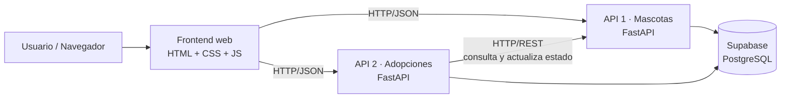

# Huellas de Esperanza: Plataforma de adopción responsable de mascotas

Plataforma web para la **Fundación Huellas de Esperanza** que centraliza la administración de mascotas disponibles para adopción y la gestión de las solicitudes de adopción. Desarrollada aplicando los principios de **Arquitectura Orientada a Servicios (SOA)** como parte del Examen 2 de la asignatura.

## Producción

| Servicio | URL |
| Frontend | https://huellas-esperanza.onrender.com |
| API 1 – Mascotas (Swagger) | https://huellas-api-mascotas.onrender.com/docs |
| API 2 – Adopciones (Swagger) | https://huellas-api-adopciones.onrender.com/docs |

Los servicios están en el plan gratuito de Render: tras ~15 minutos sin uso se "duermen" y la primera petición puede tardar entre 30 y 60 segundos.

# Problema y solución

**Problema:** la información de las mascotas y de las solicitudes de adopción estaba dispersa, lo que dificultaba consultar la disponibilidad de los animales, dar seguimiento a las solicitudes y controlar las adopciones.

**Solución:** una plataforma con dos servicios independientes (mascotas y adopciones) que se comunican por HTTP/REST, una base de datos PostgreSQL y un frontend web que permite consultar mascotas, solicitar adopciones y gestionarlas (aprobar o rechazar).

Arquitectura



### Responsabilidades de cada servicio

| Servicio | Responsabilidad | Tabla que posee |
| **API 1 – Mascotas** | Registro, consulta, actualización y disponibilidad de los animales | `mascotas` |
| **API 2 – Adopciones** | Registro, consulta y gestión (aprobar/rechazar) de solicitudes de adopción | `solicitudes` |
| **Frontend** | Interfaz web que consume ambas APIs. No habla directamente con la base de datos | — |

### Comunicación entre las APIs

La API 2 **nunca accede a la tabla `mascotas`**. Cuando necesita información o cambios sobre una mascota, le pregunta a la API 1 por HTTP/REST con JSON:

- Al **crear una solicitud**: `GET /mascotas/{id}` para verificar que la mascota existe y está `disponible`.
- Al **aprobar una solicitud**: `GET /mascotas/{id}` para validar y luego `PATCH /mascotas/{id}/estado` para marcarla como `adoptada`.
- Si la API 1 no responde, la API 2 devuelve **503** en lugar de fallar silenciosamente.

## Tecnologías

- **Backend:** Python + [FastAPI](https://fastapi.tiangolo.com/) 
- **Cliente HTTP entre servicios:** httpx
- **Base de datos:** PostgreSQL en [Supabase](https://supabase.com/)
- **Frontend:** HTML, CSS y JavaScript puro
- **Documentación de APIs:** Swagger / OpenAPI (automática en `/docs`)
- **Control de versiones:** Git y GitHub
- **Despliegue:** [Render](https://render.com/) (2 Web Services + 1 Static Site)

## 🗄️ Modelo de datos

### Tabla `mascotas` (API 1)

Campo | Tipo | Descripción 
| `id` | bigint (PK, identity) | Identificador |
| `nombre` | text, obligatorio | Nombre de la mascota |
| `especie` | text, obligatorio | Perro, gato, etc. |
| `raza` | text | Raza |
| `edad_anios` | int | Edad en años |
| `descripcion` | text | Descripción |
| `foto_url` | text | Enlace a una foto (opcional) |
| `estado` | text | `disponible` (por defecto), `en_proceso` o `adoptada` |
| `created_at` | timestamptz | Fecha de creación |

### Tabla `solicitudes` (API 2)

| Campo | Tipo | Descripción |
|---|---|---|
| `id` | bigint (PK, identity) | Identificador |
| `mascota_id` | bigint, obligatorio | Mascota solicitada |
| `nombre_solicitante` | text, obligatorio | Nombre de quien solicita |
| `email` | text, obligatorio | Correo de contacto |
| `telefono` | text | Teléfono |
| `motivo` | text | Motivo de la adopción |
| `estado` | text | `pendiente` (por defecto), `aprobada` o `rechazada` |
| `created_at` | timestamptz | Fecha de creación |

**Índice único parcial** que garantiza a nivel de base de datos que una mascota no tenga dos adopciones aprobadas:

```sql
create unique index una_aprobada_por_mascota
  on solicitudes (mascota_id)
  where estado = 'aprobada';
```

> `solicitudes.mascota_id` **no tiene llave foránea** hacia `mascotas`. Es intencional: en SOA cada servicio es dueño de sus datos y la integración se hace por la API, no por la base de datos.

## 🔌 Endpoints

### API 1 – Mascotas

| Método | Ruta | Descripción |
|---|---|---|
| GET | `/` | Estado del servicio |
| POST | `/mascotas` | Registrar una mascota |
| GET | `/mascotas` | Listar mascotas (filtro opcional `?estado=`) |
| GET | `/mascotas/{id}` | Consultar una mascota |
| PUT | `/mascotas/{id}` | Actualizar datos de una mascota |
| PATCH | `/mascotas/{id}/estado` | Cambiar la disponibilidad (`disponible`, `en_proceso`, `adoptada`) |

### API 2 – Adopciones

| Método | Ruta | Descripción |
|---|---|---|
| GET | `/` | Estado del servicio |
| POST | `/solicitudes` | Registrar una solicitud (verifica disponibilidad con la API 1) |
| GET | `/solicitudes` | Listar solicitudes (filtros opcionales `?estado=` y `?mascota_id=`) |
| GET | `/solicitudes/{id}` | Consultar una solicitud |
| PATCH | `/solicitudes/{id}/aprobar` | Aprobar la solicitud y marcar la mascota como `adoptada` |
| PATCH | `/solicitudes/{id}/rechazar` | Rechazar la solicitud |

## Reglas de negocio

1. Solo se pueden registrar solicitudes para mascotas **disponibles** (si no, responde `409`).
2. Si la mascota no existe, la solicitud falla con `404`.
3. Solo se pueden aprobar o rechazar solicitudes en estado `pendiente`.
4. **Una mascota no puede tener dos adopciones aprobadas.** Se controla con doble protección: validación en el código de la API 2 y el índice único parcial en la base de datos.
5. Al aprobar una solicitud, la API 2 le pide a la API 1 cambiar el estado de la mascota a `adoptada`.
6. Si la API de Mascotas no está disponible, la API de Adopciones responde `503`.

Decisiones técnicas

- **Dos servicios independientes**, cada uno dueño de sus datos, comunicados solo por HTTP/REST + JSON.
- **Row Level Security (RLS) activado** en Supabase: la base de datos solo es accesible a través de las APIs (con la clave secreta del servidor), nunca directamente desde el frontend.
- **Claves fuera del código:** las credenciales viven en variables de entorno (`.env` local, variables de entorno en Render). El `.env` está en `.gitignore`.
- **Un solo repositorio con una carpeta por servicio** (monorepo); cada servicio se despliega por separado apuntando a su carpeta.
- **Swagger/OpenAPI automático** gracias a FastAPI.
- **CORS habilitado** para que el frontend (otro dominio) pueda consumir las APIs.

## Estructura del repositorio

```
huellas-esperanza/
├── api-mascotas/        # API 1 (FastAPI)
│   ├── main.py
│   └── requirements.txt
├── api-adopciones/      # API 2 (FastAPI)
│   ├── main.py
│   └── requirements.txt
├── frontend/            # Interfaz web
│   └── index.html
├── .gitignore
└── README.md
```

Ejecución local

Requisitos

- Python 3.11 o 3.12 (recomendado)
- Git
- Un proyecto de Supabase con las tablas creadas (ver script abajo)

### 1. Base de datos (Supabase)

En **SQL Editor** de Supabase ejecuta:

```sql
create table mascotas (
  id bigint generated always as identity primary key,
  nombre text not null,
  especie text not null,
  raza text,
  edad_anios int,
  descripcion text,
  foto_url text,
  estado text not null default 'disponible'
    check (estado in ('disponible', 'en_proceso', 'adoptada')),
  created_at timestamptz not null default now()
);

create table solicitudes (
  id bigint generated always as identity primary key,
  mascota_id bigint not null,
  nombre_solicitante text not null,
  email text not null,
  telefono text,
  motivo text,
  estado text not null default 'pendiente'
    check (estado in ('pendiente', 'aprobada', 'rechazada')),
  created_at timestamptz not null default now()
);

create unique index una_aprobada_por_mascota
  on solicitudes (mascota_id)
  where estado = 'aprobada';
```

Elige **"Run and enable RLS"** cuando Supabase lo pregunte.

### 2. Clonar e instalar

```bash
git clone https://github.com/Nethedrake/huellas-esperanza.git
cd huellas-esperanza
python -m venv venv
venv\Scripts\activate
```

 3. Variables de entorno

Crea un archivo `.env` en **cada** carpeta de API (nunca lo subas a GitHub).

`api-mascotas/.env`
```
SUPABASE_URL=https://qzvkjgriadmhfiieklhe.supabase.co


```

`api-adopciones/.env`
```
SUPABASE_URL=https://qzvkjgriadmhfiieklhe.supabase.co
MASCOTAS_API_URL=http://127.0.0.1:8001
```

### 4. Encender los tres servicios (una terminal para cada uno)

**API 1 – Mascotas**
```bash
cd api-mascotas
python -m pip install -r requirements.txt
python -m uvicorn main:app --reload --port 8001
```

**API 2 – Adopciones**
```bash
cd api-adopciones
python -m pip install -r requirements.txt
python -m uvicorn main:app --reload --port 8002
```

**Frontend**
```bash
cd frontend
python -m http.server 5500
```

Para usar la app local, en `frontend/index.html` las constantes deben apuntar a:

```javascript
const API_MASCOTAS = "http://127.0.0.1:8001";
const API_ADOPCIONES = "http://127.0.0.1:8002";
```

| Servicio | Dirección local |
|---|---|
| Frontend | http://127.0.0.1:5500 |
| Swagger API 1 | http://127.0.0.1:8001/docs |
| Swagger API 2 | http://127.0.0.1:8002/docs |

Despliegue (Render)

| Servicio | Tipo | Root Directory | Build | Start |
| API Mascotas | Web Service | `api-mascotas` | `pip install -r requirements.txt` | `uvicorn main:app --host 0.0.0.0 --port $PORT` |
| API Adopciones | Web Service | `api-adopciones` | `pip install -r requirements.txt` | `uvicorn main:app --host 0.0.0.0 --port $PORT` |


Pruebas de integración

Flujo completo de adopción verificado sobre los servicios desplegados:

| # | Prueba | Resultado esperado |
| 1 | `POST /solicitudes` para una mascota disponible | `201`, solicitud `pendiente` |
| 2 | Segunda solicitud para la misma mascota | `201` (sigue disponible) |
| 3 | `PATCH /solicitudes/{id}/aprobar` | `200`, solicitud `aprobada` |
| 4 | `GET /mascotas/{id}` en la API 1 | Estado `adoptada` (integración real entre servicios) |
| 5 | Aprobar la segunda solicitud de la misma mascota | `409`, ya tiene una adopción aprobada |
| 6 | `POST /solicitudes` para una mascota ya adoptada | `409`, no disponible |
| 7 | `POST /solicitudes` con `mascota_id` inexistente | `404` |
| 8 | Rechazar una solicitud pendiente | `200`, solicitud `rechazada` |


##  Autores
- Juan Diego Trigos Benavides - 0192184
Proyecto académico: Examen 2, Arquitectura Orientada a Servicios · Noviembre 2026
